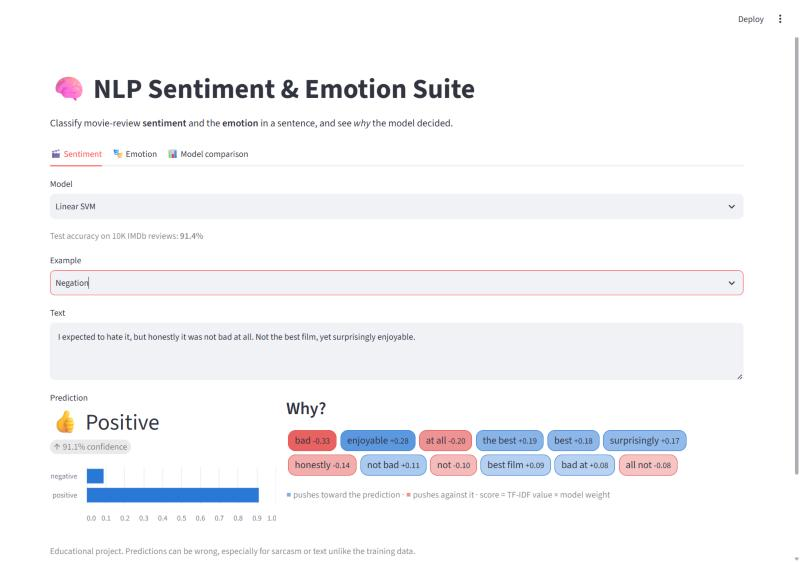
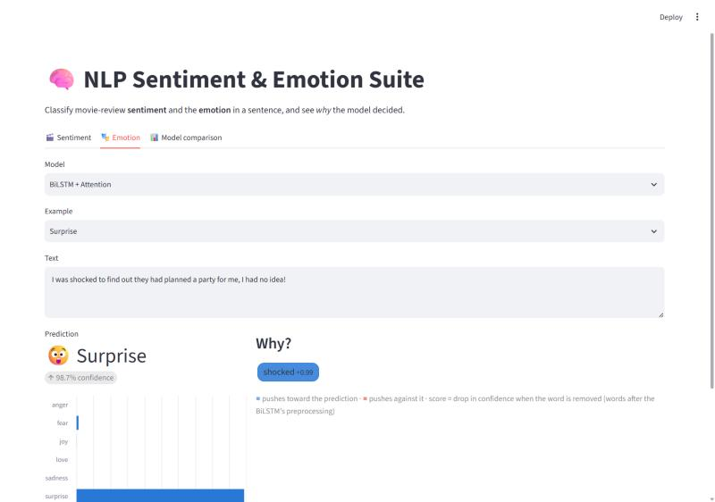
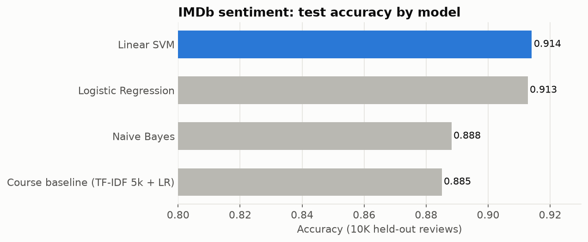
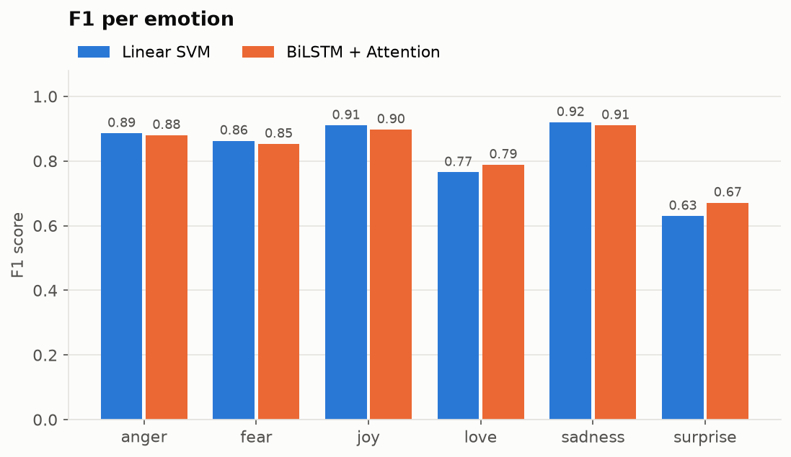
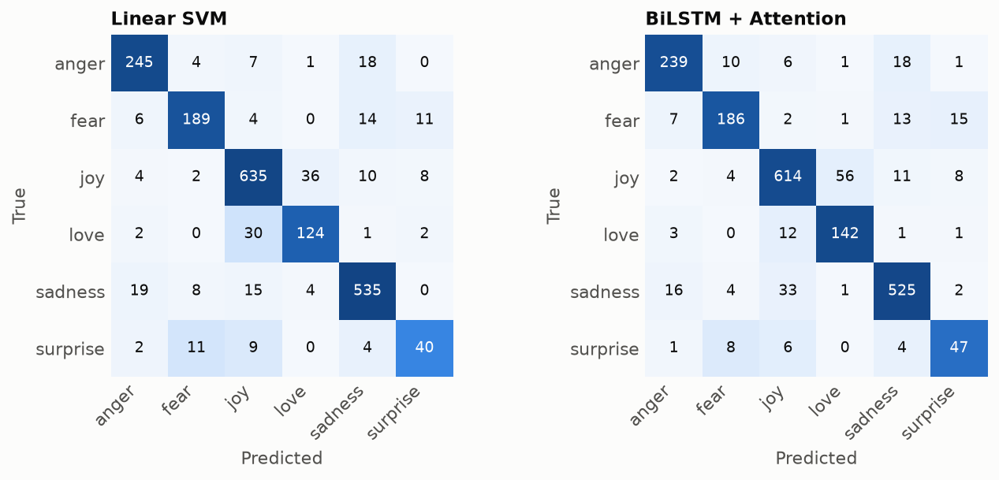

# NLP Sentiment & Emotion Suite


Two text-classification tasks, classical machine learning vs deep learning, served in one Streamlit app that also shows **why** each prediction was made.

- **Sentiment:** is an IMDb movie review positive or negative? (50K reviews)
- **Emotion:** which of 6 emotions does a sentence express? (anger, fear, joy, love, sadness, surprise; 20K sentences)

| Sentiment | Emotion (BiLSTM) |
|---|---|
|  |  |

## Results

### Sentiment (IMDb, 49,582 unique reviews)

Stratified 80/20 split. Models are compared by 3-fold cross-validation on the training set; the 9,917-review test set is only used for the final numbers.

| Model | CV Acc | Test Acc | Precision | Recall | F1 | ROC-AUC |
|---|---|---|---|---|---|---|
| **Linear SVM** | 0.909 | 0.914 | 0.909 | 0.920 | 0.915 | 0.972 |
| Logistic Regression | 0.909 | 0.913 | 0.905 | 0.923 | 0.914 | 0.972 |
| Naive Bayes | 0.886 | 0.888 | 0.883 | 0.896 | 0.889 | 0.955 |
| Course baseline (TF-IDF 5k + LR) | 0.883 | 0.885 | 0.875 | 0.900 | 0.887 | 0.956 |



**What changed from the baseline (+2.9 points):**
- **Kept stop words.** The baseline removed English stop words, which deletes "not" and "no". The tuned models keep them, so bigrams like `not good` exist as features.
- **Bigrams + 100K features** instead of 5K unigrams.
- **Sublinear TF** (`1 + log(tf)`), so a word repeated 10 times doesn't dominate a review.
- **HTML clean-up** (`<br />` tags are everywhere in IMDb).

Linear SVM and Logistic Regression are tied: they differ by less than the CV standard deviation (±0.001).

### Emotion (16K train / 2K val / 2K test)

Classical models are trained on `train` and picked by macro-F1 on `val`. The BiLSTM was trained in [the notebook](notebooks/02_emotion_bilstm_attention.ipynb) with early stopping on `val`. All models are scored on the same `test` split.

| Model | Type | Accuracy | Macro F1 | Weighted F1 |
|---|---|---|---|---|
| **Logistic Regression** | TF-IDF | 0.882 | 0.837 | 0.883 |
| BiLSTM + Attention | Deep learning (2.2M params) | 0.876 | 0.834 | 0.878 |
| Linear SVM | TF-IDF | 0.884 | 0.829 | 0.884 |
| Naive Bayes | TF-IDF | 0.760 | 0.630 | 0.741 |

<p>
  
  
</p>

**What the numbers say**
- **A linear model on TF-IDF matches the BiLSTM.** The top three are within 0.01 macro-F1 of each other. On short sentences where one keyword ("scared", "furious") usually decides the label, word counts are enough.
- **The BiLSTM is better on the rare classes** (love +0.02, surprise +0.04 F1), so macro-F1 slightly favours it over the SVM. The SVM is better on the frequent ones.
- **Most errors are joy ↔ love and fear ↔ surprise**, which are genuinely close emotions.
- **Naive Bayes collapses on rare classes** (surprise F1 0.28): its class prior pushes predictions toward joy and sadness.
- The SVM had the best validation score and is the app's default classical model, but on `test` Logistic Regression edges it out. With 2,000 test sentences, differences of about 0.01 are within noise.

### Finding: the attention layer doesn't learn word importance

The BiLSTM's attention weights turned out to be almost uniform (about 0.12–0.13 per word in an 8-word sentence). Two reasons:
1. The `tanh` scores saturate near 1.0 for every real word, so the softmax can't tell them apart.
2. Sequences are post-padded with zeros and the padding isn't masked, so **about 64% of the attention mass lands on padding**.

The model still classifies well, because the BiLSTM states carry the signal, but the attention weights don't explain anything. The app therefore explains BiLSTM predictions by **occlusion** instead: remove one word at a time and measure the drop in confidence. For *"I keep hearing noises outside and I feel scared…"*, removing `scared` drops P(fear) by 0.995, and every other word scores below 0.002.

## How explanations work

| Model | Explanation |
|---|---|
| Logistic Regression / Linear SVM / Naive Bayes | TF-IDF value of each word × the model's weight for the predicted class |
| BiLSTM | Occlusion: drop in P(predicted class) when the word is removed |

## Limitations

- **Bag-of-words can't handle some negations.** "This movie was not bad" is predicted **negative** with 99% confidence by every sentiment model: the strong weight of `bad` outweighs the bigram `not bad`. A contextual model (e.g. a fine-tuned DistilBERT) handles this.
- **Sarcasm and mixed reviews** are often misread.
- The emotion dataset is single-label English tweets-style text. Real sentences can express several emotions at once.
- The BiLSTM preprocessing (from the notebook) removes stop words including "not", so it can't see negations either.

## Project structure

```
├── app/streamlit_app.py        # Streamlit app: sentiment, emotion, model comparison
├── nlp_suite/
│   ├── text.py                 # Cleaning (TF-IDF models and the BiLSTM's original cleaning)
│   ├── data.py                 # IMDb + emotion dataset loaders
│   ├── models.py               # Candidate pipelines, TextClassifier, linear explanations
│   ├── bilstm.py               # Loads the BiLSTM, occlusion importance, attention diagnostics
│   ├── train_sentiment.py      # IMDb model comparison -> models/sentiment.joblib
│   ├── train_emotion.py        # Emotion comparison -> models/emotion_classic.joblib
│   └── reporting.py            # Charts and markdown tables
├── models/                     # Fitted models (classical joblib + BiLSTM .keras)
├── reports/                    # Metrics JSON, comparison tables, figures (generated)
├── notebooks/                  # Original exploration + BiLSTM training notebook
├── data/emotions/              # Emotion dataset (train/val/test)
└── tests/                      # pytest suite
```

## Quickstart

```bash
git clone https://github.com/arslanahmedbhutto/nlp-sentiment-emotion-suite.git
cd nlp-sentiment-emotion-suite
python -m venv .venv
source .venv/bin/activate          # Windows: .venv\Scripts\activate
pip install -r requirements.txt    # add the BiLSTM: pip install -r requirements-dl.txt
streamlit run app/streamlit_app.py
```

The trained models are included, so the app runs without retraining. TensorFlow is optional; without it the app hides the BiLSTM model.

### Retrain and compare models

The emotion data is included. The IMDb CSV (66 MB) is not: download `IMDB Dataset.csv` from [Kaggle](https://www.kaggle.com/datasets/lakshmi25npathi/imdb-dataset-of-50k-movie-reviews) into `data/imdb/`.

```bash
python -m nlp_suite.train_sentiment   # ~6 min on a 4-core CPU
python -m nlp_suite.train_emotion     # ~30 s (+ BiLSTM evaluation if TensorFlow is installed)
```

Both scripts rewrite the models, `reports/*.md`, `reports/*.json` and the figures.

### Run tests

```bash
pytest
```

The BiLSTM tests are skipped automatically when TensorFlow isn't installed (as in CI).

## Roadmap

- [ ] Fine-tune DistilBERT and add it as a third model type (should fix "not bad")
- [ ] Retrain the BiLSTM with `mask_zero=True` and without stop-word removal
- [ ] Deploy the app on Streamlit Community Cloud

## Data sources

- [IMDb Dataset of 50K Movie Reviews](https://www.kaggle.com/datasets/lakshmi25npathi/imdb-dataset-of-50k-movie-reviews) (Maas et al., 2011)
- [Emotions dataset for NLP](https://www.kaggle.com/datasets/praveengovi/emotions-dataset-for-nlp)

## Tech stack

Python · scikit-learn · TensorFlow / Keras · Streamlit · pandas · matplotlib · pytest · GitHub Actions
